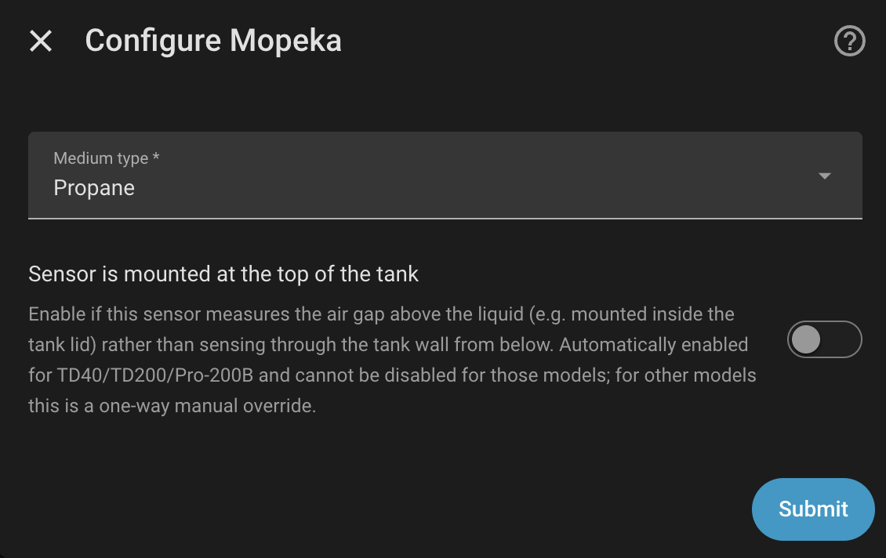
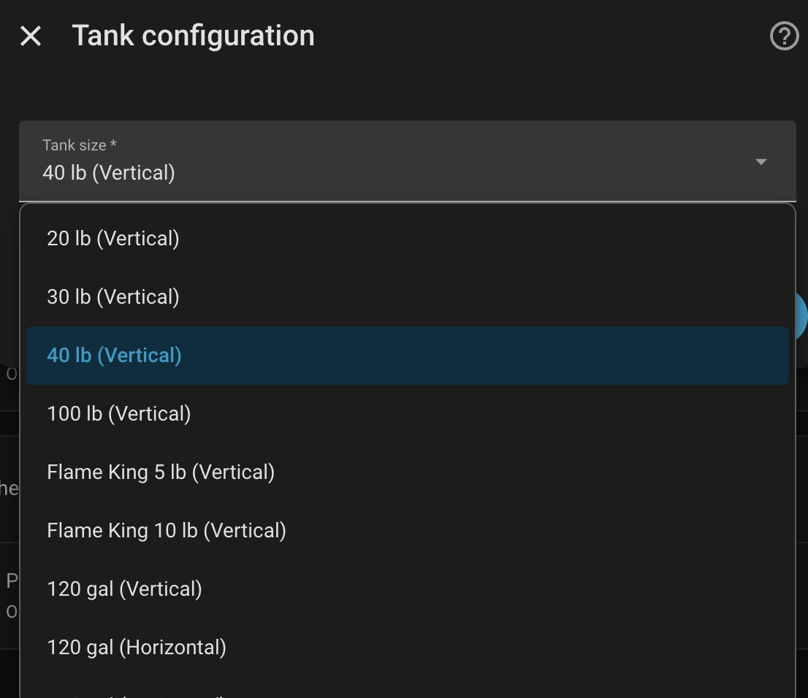
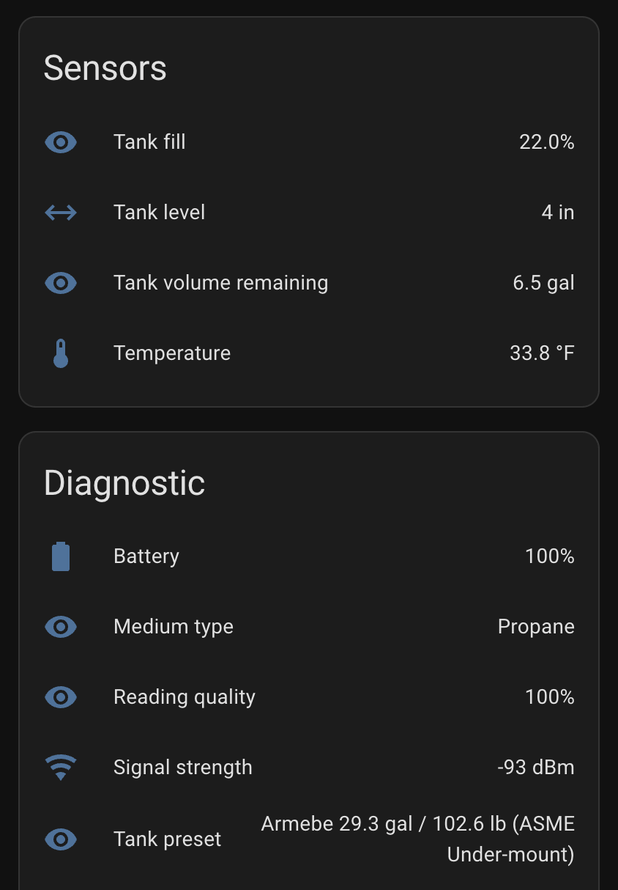

# Mopeka Enhanced

> **Development Status:** This integration is under active, heavy development. Code changes and updates are frequent. Please review the latest release notes to check for important changes or migration guidance.

        

## Intro

This is an enhanced version of Home Assistant's native Mopeka integration by `@bdraco`. It uses the same `mopeka_iot_ble` library to talk to the sensors — no changes there.

The native integration gives you a raw fluid-level reading, leaving you to build template sensors for fill percentage or remaining volume. Mopeka Enhanced adds tank presets, a guided setup flow, and ready-to-use fill and remaining-volume sensors — no templating required.

Mopeka Enhanced overrides the native HA integration while keeping your existing Mopeka devices intact. You'll need to reconfigure them once to pick up the new tank presets and sensors.

## AI Disclaimer

Yes, this was vibecoded. I'm not a developer — I'm an IT Systems Engineer with a solid grasp of what's going on. The enhancements were built with GitHub Copilot (Claude Opus/Sonnet) in the HA dev container; research and real-world verification were done by me.

The project's HA/HACS checks and tests pass. I've compared real-world readings on a 40 lb vertical propane tank, a 100 lb horizontal propane tank, and a 330 gal IBC tote (fresh water) with the Mopeka app. Horizontal preset readings can differ because this integration uses a different fill calculation.

Contributions welcome — bug fixes, efficiency improvements, docs, or additional tank presets. Maybe one day this makes it back upstream into HA core!

## Features

- 🛢️ **Propane/LPG tank presets** — vertical and horizontal tanks across North America, Europe, South Africa, New Zealand, Latin America, Israel, South Korea, the Philippines, and Bangladesh. Version 0.4.3 added 113 regional presets; Flame King and ASME tanks are also included.
- 🚰 **IBC tote presets** — 275 gal and 330 gal for non-propane media, including water and diesel.
- 📏 **Custom tanks** — enter usable fill height in millimeters and capacity. Custom propane tanks support gallons or kilograms; other media support gallons or liters.
- 📡 **Top-mount support** — TD40, TD200, and Pro-200B are detected automatically. Other sensors can use a manual top-mount override when they measure the air gap above the liquid. A separate sensor mount height accounts for headspace above the full-tank level.
- 🧭 **Guided setup** — Bluetooth discovery and manual device selection, plus reconfigure and options flows that adapt to the medium and sensor mounting position.
- 🧮 **Horizontal preset calculations** — circular-segment math converts liquid height into fill percentage for horizontal cylindrical presets.
- 📊 **Tank sensors** — raw level, fill percentage, and remaining volume in gallons, kilograms, or liters according to the selected preset or custom capacity.
- 🔎 **Diagnostics and empty-tank handling** — medium and preset labels, battery, reading quality, and other device diagnostics; low reading quality near empty latches the calculated fill at 0% until readings recover.

## A Word on Tank Presets

Non-ASME regional tank dimensions come from the `tank_types.js` file extracted from the Mopeka tank app: [mopeka-tank-types](https://github.com/bb12489/mopeka-tank-types). Some regions share tank geometry and use an existing matching preset. The Colombian horizontal 500 gal entry is excluded because its source diameter of 9000 mm needs verification.

ASME horizontal tank presets are sourced directly from manufacturer spec sheets — see the source list on the [wiki](https://github.com/bb12489/mopeka-enhanced/wiki#supported-horizontal-propane-tanks--sources).

## Screenshots

### Setup and mounting position

### Propane presets

### Sensors

## Horizontal Tank Geometry

For a horizontal cylinder, the same change in liquid height represents different amounts of liquid near the bottom and near the middle. Horizontal **presets** use a circular-segment calculation to account for that changing cross-section.

The calculation uses the preset tank's diameter and a fixed empty-reading offset, then applies its rated capacity to report the amount remaining. It models a cylindrical cross-section; it does not separately model rounded endcaps. Custom tanks currently use a **linear** height-to-fill calculation, even when the entered height is a horizontal tank's diameter. See `custom_components/mopeka/sensor.py` for the implementation.

## Top-Mount Sensors (TD40/TD200/Pro-200B)

Top-mount sensors measure the **air gap** from the sensor down to the liquid surface, rather than liquid height from the tank bottom. TD40, TD200, and Pro-200B devices are detected automatically and stay locked to AIR. For other sensors mounted at the top, enable the manual top-mount option during setup, reconfigure, or the options flow. You can turn that manual option off later through reconfigure or options.

Two heights determine the calculated fill:

- **Max Water Level Height** — the fill height at 100% full, measured from the tank bottom. Enter it for a custom tank; an IBC preset supplies it automatically.
- **Sensor mount height** (Mopeka app's "Overall Height") — the height of the sensor's own mounting point above the tank bottom. Leave at 0 if the sensor sits flush with the max-fill line (the default, matching older versions of this integration). If your sensor sits above the max-fill line (headspace, a vent, a raised fitting), set the true mounting height here so the tank can reach 100% instead of maxing out early.

For a custom tank, both heights can be set during initial setup, reconfigure, or the options flow. With an IBC preset, the maximum fill height is fixed and you enter only the sensor mount height.

## Installation (Marketplace or HACS)

Home Assistant 2026.10.0 or newer is required. Click the badge to open this repository in Marketplace on Home Assistant 2026.11 or newer, or in HACS on Home Assistant 2026.10. The existing HACS link supports both.

To add it manually on **Home Assistant 2026.11 or newer**:

1. Go to **Settings → Marketplace** and select **Add from link** in the upper-right corner.
2. Enter `https://github.com/bb12489/mopeka-enhanced` as the GitHub link and select **Add**. Marketplace may ask you to connect a GitHub account for a custom repository.
3. Open the repository in Marketplace and select **Install**.

On **Home Assistant 2026.10**, use HACS: open **HACS → Integrations → three-dot menu → Custom repositories**, add the same GitHub URL as an `Integration`, then search for `Mopeka Enhanced` and install it.

Restart Home Assistant after installing this integration because it replaces Home Assistant's built-in `mopeka` integration.

After restart, add or reconfigure your Mopeka devices from **Settings → Devices & services**.

Mopeka Enhanced doesn't configure existing devices with a tank size automatically. Reconfigure a device with a preset or a custom height to enable the fill percentage sensor; enter a custom capacity greater than zero to enable remaining volume for a custom tank.

## Acknowledgment

This custom component builds on the original Mopeka integration from Home Assistant Core. Credit to the original upstream maintainer and codeowner, `@bdraco`, for the core integration foundation.

## Development

The integration code lives in `custom_components/mopeka`.

### Code quality

This integration follows current Home Assistant development guidelines:

- Typed `ConfigEntry` with `runtime_data` (no legacy `hass.data` storage)
- Full config flow support: discovery, manual setup, reconfigure, and options flow
- Diagnostic logging on setup, unload, reload, and other key state transitions
- HA exception hierarchy (`ConfigEntryNotReady`, `HomeAssistantError`) instead of bare asserts for reachable error states
- Static type checking with `mypy` against the real `homeassistant` package, run in CI alongside `ruff`
- Two complementary test suites, both run in CI:
  - `tests/` — fast unit tests covering flow logic, tank math, and edge cases against lightweight stub modules
  - `tests_integration/` — end-to-end tests against a real Home Assistant test harness (`pytest-homeassistant-custom-component`), covering config entry setup, unload, and reload

## License

This project is released under the MIT license. See `LICENSE`.
